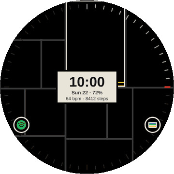
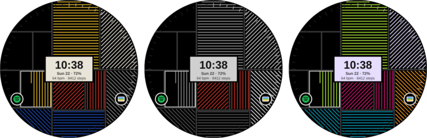
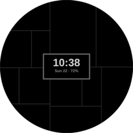

# Hatched Hour: a wall drawing that builds itself every hour

A watch face for the Galaxy Watch 4, built in **Watch Face Format v1** (resource-only, no code;
Wear OS 4 or newer). It mixes a De Stijl-style grid with Sol LeWitt-style line drawings and
builds the artwork up through the hour.



*One hour as a 12-second time-lapse. In real time the pen moves slowly and continuously.*

## Reading it

| What you see | What it means |
| --- | --- |
| Sign in the middle | Time (follows the watch's 12/24-hour setting), date, battery, heart rate, steps |
| The grid | 12 cells, one per 5 minutes, worked clockwise from 12 o'clock |
| White frame around a cell | The cell being drawn right now: minutes `:00–:04` = first cell, `:05–:09` = second… |
| Hatched cells | Finished 5-minute blocks: each cell gets parallel lines in its own direction and colour |
| The growing line | Each line grows from nothing to full length in its own time slot, so the pen is always moving |
| Tick ring | Fills up with the seconds; the coloured tick is the current second |
| 8 and 4 o'clock buttons | Your two app shortcuts (Spotify and Google Wallet) |

At :59 the drawing is finished. At :00 a new hour starts with an empty grid. There are four
seeded grids, rotated by 0°, 90° or 180° depending on the hour, so every hour on the dial looks
different.

### Palettes and always-on

Three palettes are selectable on the watch: **Primary**, **Mono + Red** and **Neon Night**.



Always-on mode shows only the grid outline and the time:



## Install on a Galaxy Watch 4 (ADB sideload)

Same steps as [Metro Rush](../metro-rush/README.md#install-on-a-galaxy-watch-4-adb-sideload),
with [`apk/hatched-hour.apk`](apk/hatched-hour.apk):

```sh
adb pair <ip>:<pairing-port>
adb connect <ip>:<port>
adb install -r hatched-hour.apk
```

Then long-press the watch face, tap **+ Add watch face** and pick **Hatched Hour**. Under
**Customise**, set the palette and choose *App shortcut → Spotify / Google Wallet* for the two
buttons. Both faces can be installed side by side.

## Develop

`app/src/main/res/raw/watchface.xml` is generated, so edit the generator instead:

```sh
python3 tools/generate.py                          # regenerate watchface.xml (stdlib only)
python3 tools/generate.py --svg 10:31:20 10:58:00@2 10:31:20~aod   # preview SVGs in docs/build/
tools/render-previews.sh                           # README media + picker preview (node+playwright, ffmpeg, ImageMagick)
./gradlew assembleRelease                          # build the APK (needs the Android SDK)
```

How it works in Watch Face Format, which has no code:

- **Grids:** each grid is a seeded subdivision, and the hatch lines are clipped to their cell
  and to the round screen. A `Condition` on `[HOUR_0_11] % 4` picks the grid, and a Group
  rotation of `floor([HOUR_0_11] / 4) * 90` turns it.
- **Lines:** each hatch line is a Group rotated to the line's direction, around the line's start
  point. Inside it, a horizontal line part's `scaleX` grows from 0 to 1 with
  `clamp((minute*60 + seconds - start) / duration, 0, 1)`.
- **Build order:** rotating a clockwise order only changes which cell comes first. So each
  line's start time includes a per-rotation offset, and drawing always begins at 12 o'clock.
