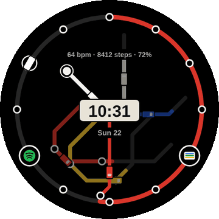
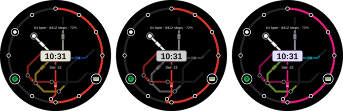
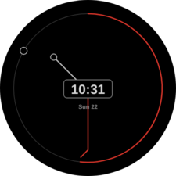

# Metro Rush — a transit-map watch face for Galaxy Watch 4

A living metro map on your wrist. Built in **Watch Face Format v1** (resource-only, no code),
so it runs on the Galaxy Watch 4 with Wear OS 4 or newer (One UI 5 Watch and later).



## Reading it

| What you see | What it means |
| --- | --- |
| Station sign in the middle | The time (follows the watch's 12/24-hour setting) and the date below it |
| White express line + ringed terminus | **Hour**, routed like a transit map (straight, then 45°) |
| Coloured express line | **Minute** — re-routes every minute |
| Coloured track filling the bezel ring | Minutes elapsed this hour |
| White train lapping the ring | **Seconds**, one lap per minute |
| Ringed station on the bezel | Current hour |
| Background network | Grows through the hour: about 25% of the track is built at :00 and nearly all of it by :59 (faint grey = track still to be built). Every minute it becomes a brand-new map, cross-fading over the last 3 seconds |
| Trains on every line | Just commuting |
| Top label | Heart rate · steps · battery |
| 8 and 4 o'clock stations | Your two app shortcuts (Spotify and Google Wallet) |

### Palettes and always-on

Three palettes are selectable on the watch: **Primary**, **Mono + Red** and **Neon Night**.



Always-on display switches to a thin, static outline version with few lit pixels:



## Install on a Galaxy Watch 4 (ADB sideload)

1. **Get the APK.** Download [`apk/metro-rush.apk`](apk/metro-rush.apk). CI rebuilds and
   commits it whenever the watch face changes. It's signed with a fixed sideload key (see
   `signing/`), so newer versions install over older ones with `adb install -r`.
2. **Enable developer mode on the watch.** Go to *Settings → About watch → Software information*
   and tap **Software version** 5 times.
3. **Enable wireless debugging.** Go to *Settings → Developer options*, turn on **ADB debugging**,
   then **Wireless debugging**. Your computer and watch must be on the same Wi-Fi network.
   Tap **Pair new device**, which shows a pairing code and an `IP:port`.
4. **Pair, connect and install** from a computer with
   [platform-tools](https://developer.android.com/tools/releases/platform-tools):
   ```sh
   adb pair <ip>:<pairing-port>      # enter the 6-digit pairing code
   adb connect <ip>:<port>           # the port shown on the Wireless debugging screen
   adb install -r metro-rush.apk
   ```
   No computer? Phone apps such as *Bugjaeger* or *Wear Installer* can do the same pair-and-install.
5. **Select it.** Long-press the current watch face, swipe to the end, tap **+ Add watch face**,
   and pick **Metro Rush**. You can also pick it in the Galaxy Wearable app on your phone.
6. **Customise.** Long-press, then **Customise**:
   - **Palette:** Primary, Mono + Red or Neon Night.
   - **Left / right station:** choose *App shortcut*, then **Spotify** and **Google Wallet**.
     The slots accept any app shortcut, so you can swap them later.

Turn **ADB debugging** off again when you're done.

## Develop

The watch face XML is generated: never edit `app/src/main/res/raw/watchface.xml` by hand.

```sh
python3 tools/generate.py              # regenerate watchface.xml (stdlib only)
python3 tools/generate.py --svg 10:31:20 10:31:58.5@2 10:31:20~aod   # preview SVGs in docs/build/
tools/render-previews.sh               # README media + watch-picker preview (needs node+playwright, ffmpeg, ImageMagick)
./gradlew assembleRelease              # build the APK (needs the Android SDK)
```

`tools/generate.py` holds a single geometry model that drives both the XML and the previews:

- Watch Face Format can't draw dynamic polylines, so each minute's map is precomputed. The file
  has a `Condition` with 60 branches for the network and minute line, and 60 more for the hour
  line in 6° steps.
- The network is a seeded random walk of 45° segments, regenerated with a new seed every minute
  and grown according to the minute of the hour.
- Trains are pure arithmetic: their position along a polyline is a sum of `clamp()` terms driven
  by `[SECOND_MILLISECOND]`, so they glide smoothly without any code.
- The minute-change "morph" is a 3-second cross-fade to the next minute's map. Watch Face Format
  can't interpolate geometry, so a true slide isn't possible.

CI (`.github/workflows/metro-rush.yml`) checks that the committed XML matches the generator,
validates it with Google's official Watch Face Format validator (format version 1), builds
the APK and, on pushes, commits it to `apk/metro-rush.apk`.

## Notes and limits

- **Heart rate** shows the watch's latest reading. It can read 0 until the watch has measured
  your pulse.
- **Battery:** the animation runs only while the screen is fully on. Always-on mode is static.
- The face hasn't been tried on a physical Watch 4 yet. CI validates the format and builds the
  APK. Please report anything odd: label spacing, train speed, the palette picker.
